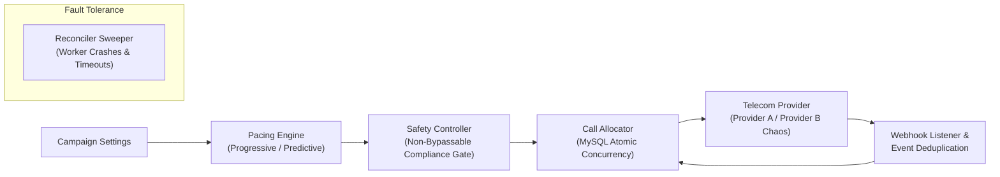

# SmartDialer: Progressive & Predictive Dialing Prototype

A production-grade, compliance-first **SmartDialer** built with **Node.js (Express)**, **MySQL 8.0 (InnoDB)**, and **React 19**.

Features both **Progressive** and **Predictive** dialing modes, a non-bypassable **Safety Controller**, mock telecom providers with chaos simulation, atomic multi-worker concurrency, and automatic failure recovery.

---

## 🏛️ System Architecture



### The Pipeline Rule:
$$\text{Campaign} \longrightarrow \text{Pacing Engine} \longrightarrow \mathbf{Safety\ Controller} \longrightarrow \text{Call Allocator} \longrightarrow \text{Telecom Provider}$$

* **Pacing Engine**: Computes recommended calls based on current free agents, active ringing calls, and statistical talk-time completion probabilities.
* **Safety Controller**: Strict gatekeeper. Approves, reduces, rejects, or forces progressive fallback if abandonment risk exceeds 3.0%, if available agents drop suddenly, or if provider health degrades.
* **Call Allocator**: Uses MySQL InnoDB row-level locking (`FOR UPDATE SKIP LOCKED` and atomic CAS updates) to eliminate race conditions across concurrent workers.
* **Reconciler Sweeper**: Automatically discovers and fixes orphaned calls or hung reservations when workers crash.

---

## 🚀 Quick Start Guide

### Prerequisites
1. **Node.js**: v18+ (tested on Node v24)
2. **MySQL**: 8.0+ running on `localhost:3306`

---

### Step 1: Configure & Start Backend (Node.js + Express + MySQL)

1. Open PowerShell / Terminal in `backend-node/`:
   ```bash
   cd backend-node
   npm install
   ```

2. Ensure your `.env` has your MySQL credentials (already pre-configured):
   ```env
   PORT=8000
   DB_HOST=localhost
   DB_USER=root
   DB_PASSWORD=your_mysql_password
   DB_NAME=smartdialer
   DB_PORT=3306
   ```

3. Initialize the MySQL tables and start the server:
   ```bash
   npm start
   ```
   *The server initializes the `smartdialer` database, seeds 50 agents and 300 borrowers, and starts listening on `http://localhost:8000`.*

---

### Step 2: Start Frontend (React + Vite)

1. Open a new terminal in `frontend/`:
   ```bash
   cd frontend
   npm install
   npm run dev
   ```

2. Open your browser at **`http://localhost:5173`**.

---

## 🧪 Running Automated Tests & Load Tests

### 1. Run the Node.js Automated Test Suite
From `backend-node/`:
```bash
npm test
```
**Results**: Runs 15 unit and integration tests covering:
* Agent & Call State Machine transitions
* Monotonic out-of-order event handling
* Duplicate webhook idempotency
* Multi-worker MySQL concurrency (two workers & 20 workers racing for the same agent)
* Safety Controller risk clamping and sudden agent dropout defense
* Worker crash recovery via Reconciler sweeper

### 2. Run the MySQL High-Concurrency Load Test
From `backend-node/`:
```bash
npm run load-test
```
**Results**:
* Executes **1,000 parallel atomic reservations and releases** across **25 simultaneous workers** against MySQL.
* Demonstrates **1,500+ operations/sec** throughput with median latency $\approx 5\text{ms}$.
* Strictly **0 double-allocation collisions** and 100% agent conservation.

---

## 🕹️ Interactive Dashboard Features

The React dashboard provides visual real-time control:

1. **Dialing Mode Toggle**:
   * Switch between **Progressive (1:1)** and **Predictive (Statistical Pacing)**.
2. **Telecom Provider Selector**:
   * **Provider A**: Fast, high-reliability telecom carrier (98%+ connection rate).
   * **Provider B (Chaos)**: Simulates 400–1200ms carrier latency, timeouts, duplicate webhooks (`ANSWERED, ANSWERED`), and out-of-order events (`COMPLETED` before `ANSWERED`).
3. **Pacing Scenario Runner** (Per Assignment Specification):
   * **Scenario A**: 20% Answer Rate, 120s Talk Time
   * **Scenario B**: 50% Answer Rate, 90s Talk Time
   * **Scenario C**: 70% Answer Rate, 180s Talk Time
   * **Scenario D**: Dynamic Changing Conditions
4. **Failure Injection Playground**:
   * ⚡ **Worker Crash Recovery**: Kills worker mid-call and triggers Reconciler sweeper to restore agent and borrower.
   * ⚠️ **Provider Outage**: Simulates carrier outage; watches Safety Controller throttle calls to 0.
   * 👥 **Sudden Agent Drop**: Drops 20–40 agents immediately; watches Safety Controller trigger the dropout circuit breaker.
   * 🔄 **Duplicate Webhooks**: Sends repeated webhooks; verifies MySQL unique constraint deduplication.
   * 🔀 **Out-of-Order Webhooks**: Delivers `COMPLETED` before `ANSWERED`; verifies terminal state lockdown.
5. **Real-time Pipeline & Audit Log**:
   * Visual inspection panel displaying the exact mathematical and compliance reasons behind every Safety Controller decision.

---

## 📂 Project Structure

```
├── backend-node/
│   ├── src/
│   │   ├── db.js                 # MySQL 8 pool, transactions & seeding
│   │   ├── models/states.js       # AgentState, CallState, DialingMode enums
│   │   ├── stateMachines.js      # Monotonic ranking & state transition rules
│   │   ├── pacingEngine.js       # Progressive & Predictive pacing calculations
│   │   ├── safetyController.js   # Non-bypassable Safety Controller
│   │   ├── allocator.js          # MySQL atomic concurrency & FOR UPDATE SKIP LOCKED
│   │   ├── providers.js          # Provider A (reliable) & Provider B (chaos)
│   │   ├── dialerEngine.js       # Multi-worker campaign orchestrator
│   │   ├── reconciler.js         # Sweeper for worker crashes & timeouts
│   │   └── server.js             # Express API & WebSocket server
│   ├── test/                     # 15 automated test cases
│   ├── schema.sql                # MySQL InnoDB relational schema
│   ├── load_test.js              # 1,000-op concurrent stress harness
│   └── package.json
├── frontend/
│   ├── src/
│   │   ├── App.jsx               # Interactive React operations dashboard
│   │   └── index.css
│   └── package.json
├── ARCHITECTURE.md               # Architecture Decision Document & Interview Q&A
└── README.md
```
